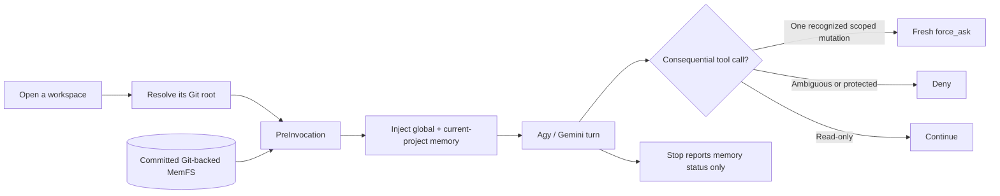

# 🧠 agy-memory-layer

[](./docs/releases/v1.25.1.md)
[](./docs/releases/v1.23.0.md)
[-success.svg)](./TEST_REPORT.md)
[](https://nodejs.org)
[](https://opensource.org/licenses/MIT)

**Persistent, Git-backed memory and evidence-controlled execution for Antigravity CLI (`agy`).**

`agy-memory-layer` helps Gemini carry useful context across conversations without treating old
summaries, uncommitted notes, or model confidence as current truth. It injects only committed global
and current-project memory, keeps learning explicit, and adds bounded safeguards for consequential
actions and completion claims.

> **Current release:** `v1.25.1` — for interactive, human-supervised use. It adds Tiered v2
> MemFS, a bundled stdio MCP server, offline Letta-grammar Memory Palace generation, and full
> migration/documentation alignment while preserving native memory, opt-in shared communication, and
> standalone operation without Letta; it does not turn Gemini into an autonomous or safety-trusted
> supervisor. See the [release notes](./docs/releases/v1.25.1.md).

## Why it exists

Long-running coding work usually fails in familiar ways:

- a new conversation forgets preferences and project decisions;
- a long conversation keeps stale assumptions after the repository changes;
- memory from one project leaks into another;
- broad approval is mistaken for permission to perform a different mutation;
- an agent reports success from a green proxy instead of the requested outcome.

This plugin gives Agy a smaller, inspectable operating layer:

| Problem | What the plugin does |
| :--- | :--- |
| Context disappears between sessions | Stores durable knowledge in a standalone Git repository |
| Memory becomes noisy or cross-project | Injects committed global memory plus only the resolved current project |
| Old prose masquerades as authority | Treats summaries, recall, and archived evidence as non-authoritative context |
| Risky mutations are ambiguous | Requests fresh confirmation for one recognized scoped action and denies unclear bundles |
| Completion claims are too confident | Binds material reviews to current files, evidence, counterexamples, and a fresh reviewer |

The result is **better continuity and fewer unsupported claims**. It does not improve Gemini's base
reasoning, product taste, or visual judgment by itself.

## Quick start

### Requirements

- Antigravity CLI (`agy`) 1.1+
- Node.js 22+
- Git 2.30+

### Install

```bash
curl -fsSL https://raw.githubusercontent.com/mahirocoko/agy-memory-layer/main/install.sh | bash
```

The one-line installer follows `main`: on a later run it fast-forwards its cached source checkout.
For a reproducible release-pinned installation, clone `v1.25.1` explicitly instead:

```bash
git clone --branch v1.25.1 --depth 1 https://github.com/mahirocoko/agy-memory-layer.git
cd agy-memory-layer
./install.sh
```

Then start a fresh Agy process or conversation and inspect the active memory:

```text
/memory
```

When you open a repository for the first time, let the plugin prepare a project-specific memory
baseline:

```text
/init
```

Calling `/init` is the confirmation: it inspects the repository, then creates and commits the
focused project-memory baseline. Review the command's scope before invoking it.

### Record the first durable preference

```text
/remember Use pnpm and exact dependency versions in this project
```

`/remember` chooses the narrowest appropriate global or project owner and persists the accepted
change through a targeted MemFS Git commit.

## How it works



The active memory store lives outside product repositories (Tiered v2 layout):

```text
~/.gemini/memory/
├── Core.md                         # concise core identity & operating posture (always-loaded)
├── index.md                        # top-level navigation map pointing to deferred children
├── system/
│   ├── index.md
│   ├── persona.md
│   └── human/**/*.md               # identity & cross-project preferences (always-loaded)
├── reference/**/*.md               # deferred global evidence + reference/index.md
├── procedures/**/*.md              # deferred reusable operational procedures + index.md
├── projects/<project-slug>/
│   ├── index.md
│   ├── system/**/*.md              # active only for the current project
│   └── reference/**/*.md           # deferred project evidence
└── archives/                       # exact provenance & migration history (never injected)
```

- `Core.md`, root `index.md`, `system/` files, and current-project `projects/<slug>/system/` files compile into `[MemFS Active Memory]` when committed.
- `reference/`, `projects/<slug>/reference/`, and `procedures/` remain deferred until discovered on demand via `agent_memory_read` or `/memory search`.
- only the current project's memory is active in that workspace.
- `archives/` preserve provenance and are never prompt-injected.
- dirty or conflicting memory is disclosed but does not silently become active.
- `Stop` never auto-commits, rewrites, or deletes memory.

Existing four-file (`v1.14` and earlier) and layered (`v1.15–v1.24`) MemFS repositories remain supported cleanly. Explicit lossless migration to Tiered v2 is available via `migrate-v2` (see [Migrating to Tiered v2](#migrating-to-tiered-v2-migrate-v2) and [Layered Memory](./docs/layered-memory.md)).

## Everyday commands

| Command | Use it when you want to… |
| :--- | :--- |
| `/memory` | inspect active memory and recent Git snapshots |
| `/remember <instruction>` | persist a preference, rule, or project fact |
| `/recall <query>` | search prior Agy conversations separately from editable memory |
| `/init` | create the first project-memory baseline for the current repository |
| `/doctor` | audit memory health, contradictions, and repository alignment |
| `/dream` | explicitly turn correction evidence into reviewable learning notes |
| `/palace` | open the offline visual Memory Palace and Git timeline |
| `/sync` | connect the standalone MemFS to a private Git remote |
| `/sync-letta` | explicitly import selected Letta Markdown as one-way evidence |
| `/persona` | inspect or propose a provenance-preserving persona switch |
| `/evidence-controller` | use the bounded evidence, delegation, and closeout workflow |
| `/contract-refine` | propose evidence-backed repository contract changes |
| `/contract-align` | align selected code with an approved frozen contract snapshot |
| `/initializing-memory` | initialize or upgrade a repository to Tiered v2 layout (`init` / `migrate-v2`) |
| `/maintaining-core-memory` | curate always-loaded Core/system memory with CAS & Lossless Retention Guard |
| `/maintaining-deferred-memory` | organize deferred `reference/`, `procedures/`, and `<dir>/index.md` files |
| `/context-doctor` | investigate behavioral context failures and audit budget/index health |
| `/syncing-memory-filesystem` | diagnose and repair draft CAS/revision conflicts or broken MemFS indexes |
| `/creating-skills` | author or refine reusable workflow skills following the repository spec |
| `/update` | refresh links, permissions, and hooks from the current installed source |

`/update` does **not** fetch a newer release. For a remote cached installation, rerun the one-line
installer first. For a local clone, update the checkout with Git and then run `/update`.

## What v1.25 adds

- **Tiered v2 MemFS (`Core.md`, `index.md`, `*/index.md`, `procedures/`)**: Separates concise always-loaded identity/rules from deferred references and procedures, guarded by YAML `read_only` checks and the Lossless Retention Guard.
- **Bundled stdio MCP server (`"agy-memory"`)**: Auto-registered via `plugins/agy-memory-layer/mcp_config.json` (`scripts/mcp-server.sh` -> `scripts/memory-mcp-server.ts`), exposing `agent_memory_read`, `agent_memory_edit`, `agent_memory_commit`, `agent_memory_manage`, `agent_memory_reflect`, and `continuity_recall` with zero external runtime dependencies.
- **Offline Letta-grammar Memory Palace default**: `scripts/palace-server.sh --open` runs `palace-render.ts` to write a private `0600` single-file HTML viewer under `~/.gemini/memory.state/viewers/palace-<project-slug>.html` (pass `--legacy` to invoke `palace-generator.ts`).
- **Six Tiered v2 workflow skills**: Adds `/initializing-memory`, `/maintaining-core-memory`, `/maintaining-deferred-memory`, `/context-doctor`, `/syncing-memory-filesystem`, and `/creating-skills` (20 skills total).

## What v1.20.0 adds

### Atomic confirmation requests

The `PreToolUse` hook classifies supported Git, shell-write, dependency, manifest, and subagent
capability changes. One unambiguous scoped mutation receives a native `force_ask`. Ambiguous gated
bundles and malformed, destructive, protected, or wrong-repository shapes fail closed. Read-only
commands remain usable.

This is a **confirmation classifier**, not authenticated authorization, a universal shell parser,
or an operating-system sandbox.

### Material-claim review

Consequential reviews can bind each claim to exact current owner and consumer bytes, required
evidence kinds, explicit counterexample probes, and fresh reviewer metadata. Verification checks the
packet structure and current bindings; it does not prove that the reviewer understood the product
or that its semantic judgment is correct.

### Bounded context recovery

The Evidence Controller asks Gemini to re-ground at coherent checkpoints and to use a fresh
conversation or reviewer when context quality drops. This is model-guided policy—not a compaction
interceptor, durable mission supervisor, deterministic conversation rotation, or automatic
continuation mechanism.

### Evidence-only Direct CLI boundary

The retained Phase 3 adapter verifies terminal Direct CLI callback receipts and repository/MemFS
snapshot invariance. Direct CLI and Herdr still own job launch, lifecycle, waiting, and cleanup; this
plugin does not supervise those runtime processes.

## Backup and migration

The standalone backup tool exports one bundle with per-file and payload SHA-256 integrity checks:

```bash
PLUGIN_ROOT="$HOME/.gemini/antigravity-cli/plugins/agy-memory-layer"
SOURCE_ROOT="$(git -C "$PLUGIN_ROOT" rev-parse --show-toplevel)"

node --experimental-strip-types "$SOURCE_ROOT/tools/memory-backup.ts" export -o ./memory-backup.json
node --experimental-strip-types "$SOURCE_ROOT/tools/memory-backup.ts" verify -i ./memory-backup.json
node --experimental-strip-types "$SOURCE_ROOT/tools/memory-backup.ts" import -i ./memory-backup.json --dry-run
```

These hashes detect accidental or cooperative-local content changes; they are not authenticated
signatures. Preview imports with `--dry-run` before applying them.

### Migrating to Tiered v2 (`migrate-v2`)

Existing MemFS repositories are never rewritten automatically on plugin update. Once MemFS is clean (`git -C ~/.gemini/memory status --short` empty) and backed up:

- **From `v1.15–v1.24` Layered MemFS**: Additive-only upgrade (`removals: []`) adds missing `Core.md`, `index.md`, and `<dir>/index.md` while keeping all `system/`, `reference/`, `projects/`, and shared communication files untouched.
- **From pre-`v1.15` Legacy 4-file MemFS**: Losslessly archives originals under `archives/legacy-v1-<head12>/` and upgrades them into `system/` and `projects/<slug>/system/` with frontmatter and indexes in one commit.

```bash
# 1. Refresh plugin links & inspect current MemFS state
./plugins/agy-memory-layer/scripts/update.sh
git -C ~/.gemini/memory status --short

# 2. Preview, apply, and verify Tiered v2 migration
node --experimental-strip-types plugins/agy-memory-layer/scripts/memory-engine.ts migrate-v2 --dry-run
node --experimental-strip-types plugins/agy-memory-layer/scripts/memory-engine.ts migrate-v2
node --experimental-strip-types plugins/agy-memory-layer/scripts/memory-engine.ts doctor
pnpm memory:health -- --workspace "$(pwd)"
./plugins/agy-memory-layer/scripts/palace-server.sh --open
```

Inside Antigravity CLI, you can invoke `agent_memory_manage({ "action": "migrate-v2", "dryRun": true })` then `agent_memory_manage({ "action": "migrate-v2" })`, or run `/initializing-memory`. To undo a migration commit safely, run `git -C ~/.gemini/memory revert --no-edit <sha>`. See [Layered Memory](./docs/layered-memory.md) for the complete legacy unit-ledger option and rollback details.

## Plugin management

```bash
# Temporarily disable or enable the plugin without deleting memory
agy plugin disable agy-memory-layer
agy plugin enable agy-memory-layer

# Remove verified plugin/config links while preserving MemFS
"$HOME/.gemini/antigravity-cli/plugins/agy-memory-layer/scripts/uninstall.sh"
```

Complete purge is intentionally separate and destructive. Consult
[Installation Details](./INSTALLATION_DETAILS.md) before changing or removing an existing setup.

## Current boundaries

Use `v1.25.1` as an **interactive, human-supervised** Agy layer:

- keep a person at the final product, visual, spend, release, and destructive-action gates;
- inspect permission UI directly—Herdr may report stale `done` while a pane still waits;
- treat declarative subagent capabilities as intent, not proven host-level confinement;
- recheck model conclusions even when packet structure and current file hashes pass;
- do not infer universal shell coverage, authenticated grants, autonomous recovery, or automatic
  continuation.

The full normative boundary lives in [CONTRACT.md](./CONTRACT.md). Retained canary evidence and the
human-accepted readiness boundary live in the
[Phase 4B readiness report](./docs/agy-main-phase4b-readiness-2026-09-13.md) and its
[bounded canary packet](./docs/evidence/agy-main-phase4b-canary-2026-09-13/README.md).

## Shared human communication adapter (v1.24.0)

When switching between Letta, Cursor, and Antigravity, common human communication preferences (such as preferred response language, conciseness, or formatting rules) can be shared across agents without copying personas, project context, or full memory stores:

**No Letta required:** normal native Agy memory, recall, and Dream work independently of Letta. Shared mode is optional and disabled by default. To share without Letta, point it at any distinct local Git repository containing a committed, regular Markdown file at `system/human/prefs/communication.md`; use the Git repository root, not a file path or subdirectory. The source still needs to pass content, size, and containment checks. Letta is one possible source, not a required service, account, runtime, or package.

- **Opt-In / Off-By-Default**: Enable via `AGY_SHARED_MEMORY_ENABLED=1` or config file outside Git memory (`~/.gemini/memory.state/shared-memory.json` or `AGY_SHARED_MEMORY_CONFIG`).
- **Fixed Shared Owner**: `system/human/prefs/communication.md`.
- **Pinned Source Revision**: Inspects committed HEAD of the explicit source repository. Symlink escapes and detected secret-like content are rejected. Uncommitted working-tree edits are never injected; unrelated dirty files do not prevent reading the committed baseline.
- **Paragraph-Level Deduplication**: Merges shared baseline while preserving distinct native additions and runtime rules. Unresolved conflicts under same headings are explained rather than overridden.
- **Protected Mutation**: Edits to the shared owner are diverted to a pending proposals queue (`memory.state/shared-proposals/`) for manual review and upstream application. Direct commits, writes, curation, migration, and reflection rewrites are prohibited.
- **Introspection Commands**:
  - `node --experimental-strip-types plugins/agy-memory-layer/scripts/shared-memory.ts status`
  - `node --experimental-strip-types plugins/agy-memory-layer/scripts/shared-memory.ts list`
  - `node --experimental-strip-types plugins/agy-memory-layer/scripts/shared-memory.ts show <id>`
  - `node --experimental-strip-types plugins/agy-memory-layer/scripts/shared-memory.ts export <id>`
  - `node --experimental-strip-types plugins/agy-memory-layer/scripts/shared-memory.ts reject <id>`
  - `node --experimental-strip-types plugins/agy-memory-layer/scripts/shared-memory.ts enable <sourceRoot>`
  - `node --experimental-strip-types plugins/agy-memory-layer/scripts/shared-memory.ts disable`

## Development and verification

```bash
pnpm install --frozen-lockfile
pnpm check
pnpm test
pnpm test:coverage
agy plugin validate plugins/agy-memory-layer
```

The `v1.25.1` release checks passed **326/326 Node tests**, **11/11 generated integration scenarios**, and
plugin validation for **20 skills, 1 rule, 3 hooks, and 1 MCP server** with zero errors (plus 9 declarative subagent role manifests under `agents/`). Its exact
historical v1.23.0 release-preparation coverage snapshot remains in its release notes; current checks and boundaries are in the [release notes](./docs/releases/v1.25.1.md).

## Documentation map

- [Project overview](./docs/project-overview.md) — architecture and product scope
- [Onboarding](./docs/onboarding.md) — contributor setup and repository paths
- [Development commands](./docs/development-commands.md) — script and maintenance reference
- [File organization](./docs/file-organization.md) — source ownership map
- [Letta parity](./docs/letta-parity.md) — current parity and non-parity boundaries
- [v1.25.1 release notes](./docs/releases/v1.25.1.md) — complete `v1.25` docs, Tiered v2 migration guide, and MCP tool alignment
- [v1.25.0 release notes](./docs/releases/v1.25.0.md) — Tiered v2 MemFS, bundled MCP server, offline Palace, checks, and limitations
- [v1.24.0 release notes](./docs/releases/v1.24.0.md) — optional shared communication, standalone use, checks, and limitations
- [v1.23.0 release notes](./docs/releases/v1.23.0.md) — human-gated Dream v2 reflection
- [v1.22.0 release notes](./docs/releases/v1.22.0.md) — lossless memory transport and curation safety
- [Generated test report](./TEST_REPORT.md) — latest integration scenario evidence

## License and acknowledgement

MIT. Inspired by the dual-memory architecture of
[Letta Code](https://github.com/letta-ai/letta-code).
