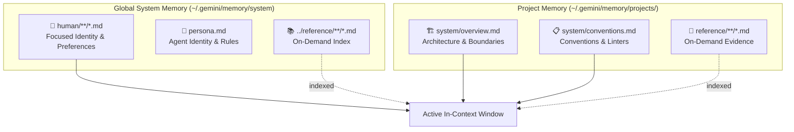

# /palace - Memory Palace Visualizer

Visual dashboard and mind-map explorer for the agent's MemFS memory blocks and Git commit history.

## Modes

1. **Offline Single-File Memory Palace (Default — Letta / `mahiro-pi` Grammar)**:
   Exports a zero-JS, single-file offline HTML viewer (`0600` private permissions at `~/.gemini/memory.state/viewers/palace-<slug>.html`) with 4 pure-CSS views (`Context`, `Core Memory`, `External Memory`, `History`), collapsible folder trees, Markdown/Raw toggle, per-file latest commit attribution, and strict current-project isolation + cross-project history redaction:
   - Via MCP: call `agent_memory_manage` with `action: "palace_export"` (or `action: "palace"` for structured JSON).
   - Via CLI:
   ```bash
   WORKSPACE_DIR="$(pwd)"
   SCRIPT_DIR="$(dirname "$(realpath "${BASH_SOURCE[0]}")")/../../scripts"
   bash "$SCRIPT_DIR/palace-server.sh" "$WORKSPACE_DIR" --open
   ```

2. **Legacy JS Browser Visualizer (Fallback)**:
   Generates the legacy interactive JS HTML dashboard (`palace-generator.ts`) when `--legacy` is explicitly requested:
   ```bash
   WORKSPACE_DIR="$(pwd)"
   SCRIPT_DIR="$(dirname "$(realpath "${BASH_SOURCE[0]}")")/../../scripts"
   bash "$SCRIPT_DIR/palace-server.sh" "$WORKSPACE_DIR" --legacy --open
   ```

3. **In-Chat Artifact Mode**:
   When viewing within the terminal or chat interface, render a structured Markdown Artifact containing:
   - 🗺️ **Mermaid Graph**: Connections between focused system owners, on-demand references, and the current project.
   - 📋 **Memory Blocks Table**: Key summaries of each active memory file.
   - 📜 **Git Timeline**: Recent snapshot history.

## Mermaid Graph Template for Chat Artifacts



## Quick Commands
- `/palace` — Open the visual Memory Palace dashboard in browser.
- `/palace --summary` — Show in-chat memory graph artifact.
